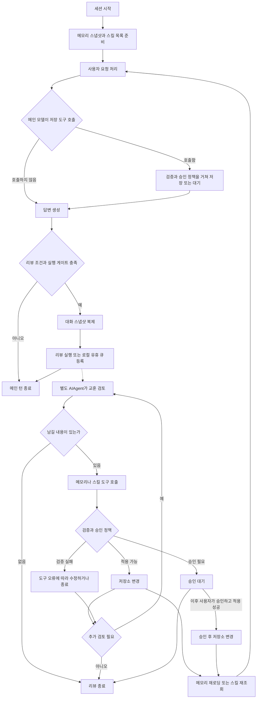

# Hermes Agent의 메모리와 스킬 자기 개선 메커니즘

Hermes는 작업 중 얻은 사실과 절차를 영구 저장하고, 이후 작업의 입력으로 다시 사용한다. 모델이 경험에서 무엇을 남길지 판단하고, Hermes 런타임이 도구 실행·저장·다음 세션의 로딩을 담당한다. 자동 리뷰가 필요할 때는 현재 대화에서 분기한 별도 에이전트 실행을 만든다. 사용자가 말한 **사이드턴**에 해당하는 것이 이 **background review fork**다.

이 문서는 개념, 실행 흐름, 상세 구현 순서로 이 구조를 설명한다. 예시는 이해를 위한 가상 상황이며 실제 메모리나 스킬을 변경한 기록이 아니다.

**구현 기준:** 로컬 저장소의 커밋 `b624a38f21f2f674d5a8ccf387687c1b481e23f6`, 확인일 2026년 10월 10일. 기본 설명은 일반 `AIAgent` 대화 루프를 기준으로 한다. 웹 문서보다 이 커밋의 실행 코드를 우선하며, 별도 런타임의 차이는 해당 절에서 구분한다. 아래 소스 링크는 이 저장소를 기준으로 한 상대 경로다.

## 1 개념

### 1.1 무엇이 개선되는가

여기서 자기 개선은 모델 가중치를 재학습하는 과정이 아니다. **같은 모델이 다음 작업에서 더 나은 지침과 경험을 입력받도록 만드는 과정**이다.

예를 들어 첫 배포에서는 패키지 관리자와 실행 순서를 잘못 골라 실패할 수 있다. 성공한 뒤 환경 사실과 절차를 저장하면, 다음 세션의 모델은 그 정보를 읽고 적절한 도구와 순서를 선택할 수 있다. 바뀐 것은 모델 파라미터가 아니라 모델이 참고하는 영구 상태다.

이를 구성하는 세 요소는 다음과 같다.

| 요소 | 역할 | 예시 |
|---|---|---|
| LLM | 대화에서 교훈을 추출하고 저장할 내용과 도구 호출을 결정 | 특정 오류를 일반적인 점검 절차로 정리 |
| Hermes 런타임 | 리뷰 실행, 도구 제한, 파일 저장과 로딩을 수행 | 조건을 만족하면 `bg-review` 스레드 시작 |
| 영구 저장소 | 세션 사이에 사실과 절차를 유지 | `MEMORY.md`, `USER.md`, `SKILL.md` |

모델의 “기억해 두었다”라는 답변만으로는 저장되지 않는다. 도구가 실제 변경을 적용했거나, 승인 대기 중이던 변경이 승인되어야 저장소가 바뀐다.

### 1.2 기억과 스킬과 대화 이력

| 구분 | 내용 | 다시 사용하는 방식 |
|---|---|---|
| `MEMORY.md` | 환경 사실, 프로젝트 규칙, 도구 특성 | 로딩 시 캡처한 내용을 시스템 프롬프트에 포함 |
| `USER.md` | 사용자에 대한 정보와 여러 작업에 공통인 선호 | 메모리와 같은 방식으로 포함 |
| 스킬의 `SKILL.md`와 보조 파일 | 특정 종류의 작업을 수행하는 절차, 분기 조건, 함정, 검증 방법 | 목록에서 관련 스킬을 발견한 뒤 필요한 내용을 도구로 읽음 |
| 세션 이력 | 과거 메시지와 도구 사용 기록 | `session_search` 등으로 필요할 때 조회 |

기본 프로필에서는 메모리가 `~/.hermes/memories/`, 스킬이 `~/.hermes/skills/`에 있다. 실제 경로는 활성 프로필과 설정에 따라 달라진다. 코드는 `get_hermes_home()`을 통해 프로필 경로를 구한다. 스킬은 프로젝트·외부 디렉터리와 별도 생성 디렉터리도 지원하므로 모든 스킬이 기본 경로에 있는 것은 아니다.

작업 방식에 관한 선호는 스킬에도 들어갈 수 있다. 예를 들어 “배포 결과에는 사용자가 접속할 주소를 포함한다”는 배포 스킬의 절차가 될 수 있고, “항상 한국어로 답한다”는 전반적인 선호는 `USER.md`의 후보가 된다. 결합 리뷰 프롬프트는 같은 선호를 양쪽에 중복 저장하지 않도록 지시한다.

근거: [메모리 저장소](../tools/memory_tool_store.py), [리뷰 프롬프트](../agent/background_review.py)의 `_MEMORY_ROUTING_BLOCK`·`_COMBINED_REVIEW_PROMPT`, [스킬 탐색](../tools/skills_tool.py).

### 1.3 스스로 저장한다는 말의 의미

저장 경로는 두 가지다.

1. **메인 턴에서 직접 저장:** 사용자 요청을 처리하던 모델이 `memory`나 `skill_manage`를 호출한다. “기억해 줘”라는 명시적 요청뿐 아니라 프롬프트의 지침에 따른 자발적인 호출도 가능하다.
2. **백그라운드 리뷰에서 저장:** 런타임이 리뷰 조건을 판단하고 대화를 복제한 뒤, 별도 모델 실행에 경험을 검토하도록 요청한다. 그 실행이 저장 도구를 호출한다.

자동성은 **지침 + 도구 + 실행 트리거 + 저장한 내용의 재사용**에서 나온다. 파일 쓰기 기능 하나만으로 이 순환이 완성되는 것은 아니다.

### 1.4 사이드턴은 실제로 무엇인가

자동 리뷰는 같은 프로세스 안의 `threading.Thread(..., daemon=True, name="bg-review")`에서 동작한다. 그 안에서 새 `AIAgent` 객체를 만들고 `run_conversation()`을 실행한다. 여기서 fork는 대화와 실행 상태에서 분기한다는 뜻이며, OS의 `fork()`로 프로세스를 복제한다는 뜻은 아니다.

리뷰에는 추가 LLM 호출과 도구 실행이 발생한다. 남길 내용이 없으면 한 번의 모델 응답으로 끝날 수도 있지만, 스킬 조회 → 수정 → 결과 확인처럼 여러 번 반복할 수도 있다. 따라서 별도 토큰 비용이 든다.

근거: [리뷰 시작점](../run_agent.py)의 `_spawn_background_review_now`, [리뷰 실행](../agent/background_review.py)의 `build_cache_parity_fork`·`_run_review_fork`.

## 2 실행 흐름

### 2.1 전체 순환



리뷰 실행은 답변을 생성한 턴의 마무리 단계에서 비동기로 시작한다. 메인 실행이 리뷰의 전체 완료를 기다리는 구조는 아니다. 다만 사용자 화면에 답변이 실제 표시되는 정확한 시점은 CLI·스트리밍·메시징 어댑터에 따라 달라지므로 “항상 화면 표시가 끝난 뒤 시작한다”는 보장은 하지 않는다.

### 2.2 리뷰는 언제 실행되는가

일반 대화 루프의 기본값은 다음과 같다.

| 구분 | 설정과 기본값 | 코드에서 세는 단위 | 추가 조건 |
|---|---|---|---|
| 메모리 리뷰 | `memory.nudge_interval: 10` | 사용자 대화 턴 | `memory` 도구가 있고 메모리 저장소가 초기화됨 |
| 스킬 리뷰 | `skills.creation_nudge_interval: 10` | 메인 루프의 iteration | `skill_manage` 도구가 있음 |

`_tick_memory_nudge()`는 턴 준비 중 카운터를 증가시키고 임계값에 도달하면 이번 턴의 메모리 리뷰 플래그를 세운다. 스킬 카운터는 `prepare_iteration()` 경로에서 증가하고 턴 마무리에서 임계값을 검사한다. **스킬 기준을 도구 함수 호출 10개라고 해석하면 안 된다.** 한 번의 모델 응답에 여러 도구 호출이 포함될 수 있으며, 일반 루프에서는 최종 답변을 얻는 반복도 계수 대상에 들어간다.

메인 턴이 `memory` 또는 `skill_manage` 호출의 실행 지점에 도달하면 대응 카운터를 초기화한다. 초기화는 저장 성공을 확인한 뒤가 아니라 도구 실행 전이다. 이미 결정한 이번 턴의 메모리 리뷰 플래그와 이후 카운터 값도 서로 구분해야 한다.

자동 리뷰를 시작하려면 최종 응답이 존재하고 턴이 중단되지 않았으며, 일반 경로의 `skip_background_review`가 꺼져 있어야 한다. 이어 `_spawn_background_review()`에서 자동 리뷰 활성화 설정과 위임 깊이를 검사한다. 메모리와 스킬 조건이 동시에 충족되면 두 리뷰를 따로 생성하지 않고 **결합 프롬프트를 사용하는 리뷰 하나**를 만든다.

예를 들어 도구 사용 없이 짧게 답하는 대화가 이어져도 메모리 턴 기준은 찰 수 있다. 반대로 복잡한 작업 하나가 많은 반복을 요구하면 한 사용자 턴 안에서 스킬 리뷰 기준에 도달할 수 있다. 임계값 도달은 리뷰 기회이며, 반드시 새 파일이나 새 기억이 생긴다는 뜻은 아니다.

근거: [초기값](../agent/agent_init.py)의 `_init_memory`·`_apply_agent_section`, [메모리 트리거](../agent/turn_context.py)의 `_tick_memory_nudge`, [반복 계수](../agent/turn_iteration_prep.py), [턴 마무리](../agent/turn_finalizer.py), [카운터 초기화](../agent/tool_executor.py).

### 2.3 예시로 보는 한 번의 학습

가상 프로젝트에서 사용자가 “테스트가 통과하는지 확인하고 변경 내용을 설명해 줘”라고 요청했다고 하자.

1. 메인 에이전트가 `npm test`를 실행했지만 프로젝트 구성과 맞지 않아 실패한다.
2. 저장소 문서를 읽고 이 프로젝트가 `pnpm`을 사용한다는 사실을 확인한다.
3. 안내된 테스트 명령으로 다시 실행하여 통과 결과를 얻는다.
4. 사용자에게 결과를 설명한다. 이 과정에서 메인 에이전트가 환경 사실을 바로 저장할 수도 있다.
5. 리뷰 조건이 충족되면 런타임이 대화 사본과 리뷰 지침을 별도 에이전트에 전달한다.
6. 리뷰 에이전트는 기존 스킬을 읽고 “테스트 전에 저장소의 개발 지침과 패키지 관리자 설정을 확인한다”는 절차가 빠졌는지 판단한다.
7. 빠진 절차가 있다면 기존 테스트 스킬에 추가한다. 기존 규칙과 동일하면 중복 추가하지 않거나 설명을 보완한다.
8. 이후 관련 작업에서 모델이 그 스킬을 읽으면 명령 선택 전에 설정을 확인할 수 있다.

환경 사실의 저장 호출은 다음과 같은 형태가 될 수 있다. 아래는 **설명용 도구 인자**다.

```json
{
  "action": "add",
  "target": "memory",
  "content": "프로젝트 sample-app은 pnpm을 사용한다."
}
```

스킬에 남기는 절차는 다음처럼 일반화할 수 있다.

> 테스트 실행 전에 저장소의 개발 지침, packageManager 설정, lockfile을 확인한다. 지정된 패키지 관리자와 테스트 스크립트를 사용하고, 실행 결과를 확인한 뒤 통과 여부를 보고한다.

“앞으로 모든 프로젝트에서 pnpm을 사용한다”는 결론은 이 경험의 범위를 벗어난다. 자기 개선의 핵심은 성공 경험을 적용 조건과 함께 저장하는 것이다.

### 2.4 저장 후 언제 행동이 바뀌는가

내장 메모리는 디스크 내용과 시스템 프롬프트의 스냅샷을 구분한다. 중간에 저장하면 파일과 저장소의 현재 상태는 바뀌지만, 저장할 때마다 기존 시스템 프롬프트를 다시 만들지는 않는다. 새로운 세션에서 메모리를 로딩할 때 새 내용이 반영된다. **같은 세션에서도 문맥 압축은 예외다.** `invalidate_system_prompt()`는 메모리를 디스크에서 다시 읽고 캐시를 무효화하므로, 압축 후 프롬프트를 다시 구성하는 경계에서도 변경을 반영할 수 있다.

메인 턴이 직접 저장했다면 해당 내용은 현재 대화와 도구 결과에도 있으므로 그 턴에서 사용할 수 있다. 반면 백그라운드 리뷰의 추론 전체가 메인 대화에 합쳐지는 것은 아니다. 스킬 파일의 변경은 이후 해당 스킬을 다시 읽을 때 사용할 수 있지만, 이미 읽었던 텍스트가 자동 교체되거나 현재 시스템 프롬프트의 목록이 즉시 다시 작성되는 것은 아니다.

근거: [메모리 스냅샷](../tools/memory_tool_store.py)의 `load_from_disk`·`format_for_system_prompt`, [시스템 프롬프트](../agent/system_prompt.py), [리뷰 격리](../agent/background_review.py)의 `build_cache_parity_fork`.

## 3 상세 구조

### 3.1 메인 실행과 리뷰 실행 사이의 경계

| 상태 | 리뷰에서의 처리 | 목적 |
|---|---|---|
| 대화 메시지 | 중첩된 내용까지 구조적으로 복제 | 리뷰의 정리 작업이 메인 대화를 변경하지 않게 함 |
| `AIAgent` | 새 객체 생성 | 별도의 루프와 실행 상태 확보 |
| 내장 `MemoryStore` | 부모의 저장소 객체를 연결 | 실제 메모리 저장에 반영 |
| 스킬 | 활성 프로필과 설정이 가리키는 파일에 도구로 접근 | 이후 작업에서 재사용할 절차 변경 |
| 시스템 프롬프트와 도구 스키마 | 같은 모델 경로에서는 부모와 동일하게 유지 | 프롬프트 캐시 재사용 기회 확보 |
| 세션 ID | 부모 ID를 사용 | 캐시 식별과 사용량 연결 |
| 대화 DB 쓰기 | `_persist_disabled=True`, `_session_db=None` | 리뷰 지침과 대화가 본 대화 이력에 섞이지 않게 함 |
| 외부 메모리 제공자 | fork 초기화에서 `skip_memory=True`로 생략 | 내부 리뷰 대화를 외부 사용자 기억에 보내지 않게 함 |
| 자동 리뷰 간격 | 두 간격을 0으로 설정 | 리뷰가 다시 자동 리뷰를 생성하는 재귀 방지 |

리뷰의 대화 저장을 끄는 것과 사용량 기록을 끄는 것은 다르다. 리뷰 사용량은 별도로 부모 세션에 귀속시킨다. 부모와 같은 세션 ID를 사용한다고 해서 대화 객체와 DB 쓰기까지 공유하는 것은 아니다.

근거: [메시지 복제](../agent/turn_finalizer.py)의 `_clone_background_review_messages`, [fork 구성과 사용량](../agent/background_review.py)의 `build_cache_parity_fork`·`_record_review_usage_to_parent`.

### 3.2 실제 호출 순서

일반 루프의 자동 리뷰를 함수 수준으로 줄이면 다음과 같다.

```text
agent/turn_context.py
  _tick_memory_nudge()
    이번 턴의 메모리 리뷰 여부 계산

agent/turn_iteration_prep.py
  반복마다 스킬 카운터 증가

agent/turn_finalizer.py
  스킬 리뷰 여부와 자동 실행 조건 검사
  agent._spawn_background_review(...)

run_agent.py
  _spawn_background_review()
    설정과 위임 깊이 검사
    대화 구조 복제
    필요하면 로컬 유휴 큐에 등록
  _spawn_background_review_now()
    실행 중복 방지 토큰 확보
    프로필 문맥을 이어받은 bg-review 스레드 시작

agent/background_review.py
  spawn_background_review_thread()
    메모리 전용 / 스킬 전용 / 결합 프롬프트 선택
  _run_review_in_thread()
    해당 스레드의 일반 출력을 억제
  _run_review_fork()
    build_cache_parity_fork()
    실행 도구 허용 목록 설정
    review_agent.run_conversation(리뷰 지침, 대화 사본)
      LLM 호출 → 도구 실행 → 도구 결과 → 필요하면 반복
    부모 세션에 사용량 기록
    클라이언트 자원 해제
  summarize_background_review_actions()
    새로 적용된 도구 결과를 바탕으로 변경 알림 구성
```

리뷰용 지침은 새 실행의 `user_message`로 전달된다. 사용자가 채팅창에 입력한 메시지는 아니며 런타임이 만든 작업 지시다. 이것이 “사용자의 새 요청 없이 추가 턴이 실행되는” 직접적인 메커니즘이다.

### 3.3 리뷰가 무엇을 배우도록 지시하는가

리뷰 프롬프트는 저장 판단을 모델에 맡기되 기준을 제공한다.

- 메모리 리뷰는 사용자 정보와 환경 사실을 구분하고, 남길 것이 없으면 종료하도록 한다.
- 스킬 리뷰는 사용자의 수정 요청, 누락된 절차, 유효한 해결 방법, 오래된 지침을 학습 신호로 본다.
- 현재 작업에서 읽었던 스킬 수정 → 다른 기존 스킬 수정 → 보조 파일 추가 → 새 스킬 생성 순서를 우선한다.
- 세션마다 파일을 쌓거나 실패 로그를 그대로 옮기기보다, 작업 종류에 재사용할 절차와 적용 조건을 남기도록 한다.
- 실패한 시도만 있는 작업을 검증된 성공 절차로 포장하지 않도록 지시한다.

스킬 리뷰 프롬프트는 적극적인 업데이트를 강하게 유도한다. 그렇다고 매 리뷰에 변경이 강제되는 것은 아니다. 남길 신호가 없으면 종료하는 선택지도 있다. 또한 프롬프트의 품질 지침은 모델에 대한 요청이므로 기계적으로 보장되는 제약과 구분해야 한다.

근거: [리뷰 프롬프트](../agent/background_review.py)의 `_MEMORY_REVIEW_PROMPT`·`_SKILL_REVIEW_PROMPT`·`_COMBINED_REVIEW_PROMPT`·`_DO_NOT_CAPTURE_BLOCK`.

### 3.4 캐시를 유지하면서 실행 도구를 제한하는 방법

같은 모델로 실행할 때 리뷰는 부모의 시스템 프롬프트, 도구 스키마, reasoning 설정과 캐시 범위를 이어받는다. 도구 목록을 좁혀 다시 만들면 요청 접두부가 달라져 캐시 재사용에 불리하기 때문이다. 실제 캐시 적중 여부와 비용은 제공자와 캐시 상태에 따라 달라진다.

이 구성은 첫 요청에서 부모의 접두부를 재사용하기 위한 것이다. 이후 리뷰 자체의 문맥은 따로 압축될 수 있다. 압축기를 부모 DB에서 분리한 경우에만 리뷰의 압축을 활성화하고 첫 응답 전까지 압축을 미룬다. 분리에 실패하면 리뷰의 압축을 끈다. 리뷰 문맥이 압축되어 부모와 달라진 뒤에는 일부 제공자의 캐시 범위도 리뷰용으로 구분한다.

실행 권한은 **도구 실행 시점의 허용 목록**으로 제한한다.

| 도구 종류 | 기본 리뷰의 실행 허용 |
|---|---|
| 스킬 목록·조회·관리 | 허용 목록에 포함 |
| `read_file`, `search_files` | 읽기용으로 포함 |
| 내장 `memory` | 메모리 기능이 켜져 있고 `review_memory=True`일 때 포함 |
| 일반 `terminal`, 파일 쓰기 도구 등 | 기본적으로 제외 |
| 설정의 `extra_tools` | 지정된 도구를 추가 허용하되, 원래 사용 가능한 도구여야 함 |

따라서 스킬 조건만으로 시작한 리뷰는 기본적으로 내장 메모리를 수정할 수 없다. 반대로 메모리 리뷰에서 스킬 도구가 함께 허용될 수 있으므로 프롬프트의 주제와 실행 권한을 완전히 동일하게 해석해서도 안 된다.

도구 스키마에 보인다는 사실만으로 호출이 허용되는 것은 아니다. 리뷰가 허용되지 않은 도구를 요청하면 실행 계층에서 거절한다. 위험 명령 승인 요청에도 비대화형 거절 콜백을 설정해 백그라운드 스레드가 사용자 입력을 기다리지 않도록 한다.

근거: [도구 상속과 실행 제한](../agent/background_review.py)의 `_inherit_parent_tool_surface`·`_review_tool_whitelist`·`_run_review_fork`·`_bg_review_auto_deny`.

### 3.5 메모리 저장의 내부 동작

`memory`는 `add`, `replace`, `remove` 및 일괄 `operations`를 받는다. 저장 도구는 대상과 입력을 확인하고 승인 정책을 적용한 뒤 `MemoryStore`를 통해 변경한다.

`MemoryStore`는 파일 잠금 안에서 디스크의 현재 내용을 다시 읽고, 변경을 검증한 후 원자적으로 파일을 교체한다. 이렇게 해야 이전에 읽은 오래된 상태를 그대로 덮어쓰는 문제를 줄일 수 있다. 이 장치는 동시 쓰기의 파일 무결성을 위한 것이며, 여러 에이전트의 의미적으로 모순된 기억까지 자동 해결하는 것은 아니다.

기본 크기 제한은 `MEMORY.md` 2,200자, `USER.md` 1,375자다. 토큰 수가 아니라 문자 수 기준이며 설정으로 변경할 수 있다. 용량을 넘으면 자동으로 오래된 항목을 버리지 않고 오류를 돌려준다. 모델은 내용을 줄이거나 기존 항목을 정리하는 호출을 제안할 수 있다. 자동 리뷰의 교체·삭제에는 아래 별도 제한이 적용된다.

`replace`의 `old_text`는 바꿀 항목을 찾는 조건이고, `content`는 그 항목 전체의 새 내용이다. 문자열 일부만 치환하는 명령으로 이해하면 기존 내용 일부를 잃을 수 있다.

근거: [메모리 도구](../tools/memory_tool.py), [저장 구현](../tools/memory_tool_store.py)의 `_mutate`·`replace`·`apply_batch`·`format_for_system_prompt`.

### 3.6 스킬 생성과 수정의 내부 동작

스킬은 Markdown 지침에 필요에 따라 실행 스크립트와 참고 자료를 묶은 파일 집합이다. `skill_manage`는 생성·수정·부분 패치·보조 파일 쓰기 등을 처리한다. 파일 이름과 경로, frontmatter와 크기의 검증은 도구 계층에서 다룬다.

에이전트가 작성한 스킬의 추가 보안 스캔은 `skills.guard_agent_created: true`로 켜는 선택 기능이며 기본값은 `false`다. 켜져 있어도 스캐너 자체의 예외는 로그를 남긴 뒤 통과시킨다. 따라서 스킬의 모든 변경이 기본적으로 보안 스캔을 통과한다고 해석하면 안 된다. 허브에서 설치하는 스킬의 검사 정책과도 구분해야 한다.

자동 리뷰가 기존 파일 변경을 직접 적용하려면 해당 리뷰 실행 안에서 파일을 먼저 읽어야 한다. 이전 대화에 같은 스킬 내용이 등장했다는 사실만으로는 충분하지 않다. `skill_view` 또는 지원되는 파일 읽기 경로가 읽기 기록을 남기고, 쓰기 가드가 이를 확인한다. 새 스킬이나 아직 없는 보조 파일을 추가할 때는 기존 파일을 읽을 필요가 없다. 다만 승인 게이트는 실제 변경 처리보다 앞서므로, 승인 모드에서는 읽지 않은 수정안도 먼저 대기 제안으로 등록될 수 있다. 대기 등록은 읽기 검증이나 실제 적용의 성공을 의미하지 않는다.

개념적인 도구 순서는 다음과 같다.

```text
skills_list()
    ↓ 관련된 기존 스킬 탐색
skill_view(name="project-testing")
    ↓ 이 리뷰 안에서 현재 파일 읽기
skill_manage(action="patch", name="project-testing", ...)
    ↓ 승인 정책과 변경 검증
적용 결과 확인 또는 승인 대기
```

새 스킬을 만들었더라도 이후 작업에서 발견하고 읽어야 행동에 영향을 준다. 스킬 생성 자체가 모델의 실행 코드를 즉시 확장하는 것은 아니다. 보조 스크립트가 있다면 나중에 스킬을 사용하는 에이전트가 적절한 도구로 실행한다.

근거: [스킬 관리](../tools/skill_manager_tool.py), [리뷰 읽기 가드](../tools/skill_manager_guards.py), [스킬 로딩](../tools/skills_tool.py)의 `skills_list`·`skill_view`.

### 3.7 자동 저장과 승인 대기의 구분

기본 설정의 `memory.write_approval`과 `skills.write_approval`은 `false`다. 일반적인 추가·수정은 다른 검증을 통과하면 적용할 수 있다. 그러나 이를 “모든 자동 변경이 무제한 허용된다”로 읽으면 안 된다.

| 상황 | 처리 |
|---|---|
| 자동 리뷰의 메모리 `add` | 메모리 리뷰 권한·용량·검증·일반 승인 정책을 통과하면 적용 |
| 무인 자동 리뷰의 메모리 `replace`·`remove` | 일반 승인 설정이 꺼져 있어도 승인 대기로 보냄 |
| 위 연산이 포함된 메모리 배치 | 해당 배치를 승인 대기로 보냄 |
| `memory.write_approval: true` | 메모리 변경에 승인 게이트 적용 |
| `skills.write_approval: true` | 스킬 변경을 승인 대기로 보냄 |
| 자동 리뷰가 기존 스킬을 직접 변경할 때 읽기 누락 | 실제 변경 경로의 쓰기 가드가 거절. 승인 모드에서는 제안 등록이 먼저 일어날 수 있음 |

승인 대기 결과의 `success: true`는 제안 등록 성공일 수 있다. `staged: true`를 함께 확인해야 하며, 이를 파일 변경 성공으로 보고하면 안 된다. 대기 제안은 `/memory pending`, `/skills pending` 등으로 확인한다.

리뷰 프롬프트는 스킬을 삭제하지 말고 겹치는 내용의 정리는 curator에 맡기라고 지시한다. 실제 삭제 도구에도 pinned·소유권·통합 대상 등의 가드가 있다. 프롬프트의 삭제 금지 지시와 도구가 구현한 세부 삭제 조건은 별개의 계층이다.

근거: [자동 메모리 교체와 삭제의 게이트](../tools/memory_tool.py)의 `_background_delete_gate`, [스킬 승인](../tools/skill_manager_tool.py)의 `_run_write_gate`, [삭제 가드](../tools/skill_manager_guards.py).

### 3.8 모델 선택과 비용 제한

기본 리뷰는 부모의 현재 모델과 실행 설정을 바탕으로 구성한다. 같은 모델 경로는 처음에 대화 스냅샷 전체를 재사용하고 부모의 reasoning 설정을 유지한다. `auxiliary.background_review.reasoning_effort`만 따로 지정해도 같은 모델 경로에서는 독립적으로 적용하지 않는다. 부모가 `codex_app_server`를 쓰는 경우에는 리뷰의 API 모드를 `codex_responses`로 전환한다. 같은 모델을 사용한다는 것이 실행 방식 전체를 그대로 복제한다는 뜻은 아니다.

이 커밋에서 다른 경로를 선택하려면 `auxiliary.background_review`에 명시적인 `provider`와 `model`을 함께 지정해야 한다. 부모와 다른 경로로 분기하면 오래된 메시지는 짧은 digest로 만들고 최근 메시지는 유지한다. **이 digest는 별도 LLM 요약이 아니라 코드가 텍스트와 도구 이름을 추출·절단해 만든다.** 기본적으로 최근 24개 메시지를 보존하되 도구 결과만 분리되지 않게 경계를 조정한다. 라우팅을 해석하지 못하면 경고 후 부모 경로로 돌아간다.

리뷰는 `max_iterations=16`으로 에이전트를 구성한다. 또 `max_input_tokens`로 리뷰 전체의 누적 입력 토큰을 제한한다. 미설정 시 모델 문맥 길이의 75%와 600,000 중 작은 값이며, 문맥 길이를 알 수 없으면 120,000을 사용한다. 0 이하는 해당 입력 예산 제한을 끈다.

예산 검사는 다음 반복의 시작에서 이미 사용한 입력량을 확인한다. 따라서 설정값은 한 요청도 넘길 수 없는 사전 예약 한도가 아니다. 한 요청이 예산을 넘어선 뒤 다음 반복을 중단할 수 있다. 캐시가 적중하더라도 반복 호출마다 입력 처리와 새 출력 비용은 발생할 수 있다.

근거: [모델 라우팅과 digest](../agent/background_review.py)의 `_resolve_review_runtime`·`_digest_history`·`_review_input_token_budget`, [예산 검사](../agent/conversation_loop.py)의 `_review_input_budget_exhausted`.

### 3.9 실행 시점과 중단

일반적인 원격 모델 리뷰는 조건을 만족하면 백그라운드 스레드를 시작한다. 관리형 로컬 `llama-server`가 리뷰 대상이고 `defer: auto`이면 GPU 경합을 줄이기 위해 유휴 큐에 넣는다. 이는 모든 로컬 서버나 모든 제공자에 일괄 적용되는 정책이 아니다.

트리거를 통과해 스레드가 시작되어도 실제 모델 실행을 생략하는 조건이 있다. 부모 제공자의 client가 `SUPPORTS_HERMES_TOOL_CALLS=False`를 선언하고 다른 리뷰 경로로 라우팅되지 않았다면 저장 도구를 실행할 수 없으므로 리뷰를 생략한다. 이 경우 도구 호출을 지원하는 리뷰용 provider와 model을 별도로 지정해야 한다.

유휴 큐는 세션별 최신 스냅샷으로 항목을 합치고, 일정 시간 대기한 항목은 기한 조건으로 실행할 수 있다. 큐는 메모리에 있으므로 프로세스 재시작 후 복구되는 영구 작업 큐가 아니다.

새 라이브 턴은 실행 중 리뷰의 취소를 요청한다. 취소 확인은 최대 2초 기다린 뒤 메인 작업을 진행한다. 취소가 이미 적용된 메모리·스킬 변경을 모두 되돌린다는 뜻은 아니다. 지연 실행 모드에서는 선점된 리뷰를 제한된 횟수로 다시 큐에 넣는 경로도 있다.

수동 `/refine`도 같은 리뷰 실행부를 사용하고 `explicit=True`를 전달해 유휴 지연을 생략한다. 시작된 수동 리뷰에는 `_review_attended=True`를 설정하므로, 무인 리뷰 전용 메모리 `replace`·`remove` 대기 규칙은 적용하지 않는다. 일반 쓰기 승인 설정은 계속 적용받는다.

다만 이 커밋의 활성화·위임 검사 우회는 `explicit`이 아니라 `focus is None` 여부에 연결되어 있다. **자동 리뷰를 껐을 때 인자 없는 `/refine`은 막힐 수 있고, 초점 문자열이 있는 `/refine 테스트 절차를 정리해`는 다른 경로를 탄다.** 따라서 “자동 리뷰를 꺼도 `/refine`은 항상 실행된다”고 일반화하면 코드와 맞지 않는다.

근거: [시작과 재등록](../run_agent.py)의 `_spawn_background_review`·`_maybe_requeue_preempted_review`, [유휴 큐](../agent/review_idle_queue.py), [취소](../agent/background_review.py)의 `cancel_background_review_for_live_turn`, [CLI 수동 실행](../hermes_cli/cli_commands_mixin.py)의 `_handle_refine_command`.

### 3.10 비슷해 보이는 다른 기능과의 경계

| 기능 | 이 문서의 자동 리뷰와 다른 점 |
|---|---|
| `/review` | 독립 리뷰 하위 에이전트를 위임하여 평가 결과를 대화로 돌려주는 경로 |
| `/refine` | 메모리·스킬 학습 리뷰를 명시적으로 요청하는 경로 |
| 스킬 curator | 스킬 라이브러리의 관리와 통합을 담당하는 별도 기능 |
| 외부 메모리 제공자 | 제공자별 저장·검색·사용자 모델링 수명주기를 가지는 별도 계층 |
| 문맥 압축 | 길어진 현재 대화를 줄여 실행을 이어가기 위한 기능 |

자동 리뷰와 `/btw` 같은 옆 질문 기능은 `build_cache_parity_fork`라는 구성 부품을 공유할 수 있지만, 목적과 실행 권한과 결과 전달 방식까지 동일하지는 않다.

별도 `codex_app_server` 경로는 `agent/codex_runtime.py`의 `_finish_codex_turn()`에서 스킬 반복 수와 리뷰를 처리한다. 이 경로는 일반 루프와 계수 방법이 다르고, 해당 종료 함수에는 일반 `turn_finalizer`와 같은 `skip_background_review` 검사가 보이지 않는다. 따라서 일반 루프의 모든 게이트를 모든 런타임에 동일하게 적용된다고 설명하지 않는다.

근거: [일반 리뷰 위임](../agent/review_engine.py), [curator](../agent/curator.py), [외부 메모리 관리](../agent/memory_manager.py), [별도 런타임의 종료 처리](../agent/codex_runtime.py).

### 3.11 개선의 한계와 확인 방법

이 구조가 보장하는 것은 경험을 저장하고 재사용할 실행 경로다. 저장한 교훈이 언제나 정확하거나 다음 작업의 성공률을 높인다는 보장은 아니다. 읽기 가드, 용량 제한, 적용되는 승인 정책과 선택적으로 켠 스킬 보안 검사는 잘못된 쓰기를 줄이지만 절차의 의미적 정확성까지 증명하지 않는다.

개선이 실제로 일어났는지는 다음 연결을 확인해야 한다.

1. 저장 도구가 실제 변경을 적용했는가, 아니면 승인 대기인가.
2. 저장한 내용이 경험으로 뒷받침되며 적용 조건이 명확한가.
3. 이후 작업이 그 메모리나 스킬을 실제로 읽었는가.
4. 동일한 조건의 작업에서 반복 오류, 사용자 수정, 불필요한 도구 호출이 줄었는가.

`display.memory_notifications`는 변경 알림의 표시 수준을 조정한다. 알림을 꺼도 리뷰 실행과 저장은 별개로 계속될 수 있다. 변경 여부는 알림 문구만으로 판단하지 말고 도구 결과, 실제 파일, 승인 대기를 함께 본다.

## 4 소스 탐색 안내

| 확인할 질문 | 시작할 파일과 심볼 |
|---|---|
| 기본 주기와 저장소가 어디서 설정되는가 | [agent_init.py](../agent/agent_init.py) — `_init_memory`, `_apply_agent_section` |
| 언제 리뷰할지 누가 판단하는가 | [turn_context.py](../agent/turn_context.py) — `_tick_memory_nudge`; [turn_finalizer.py](../agent/turn_finalizer.py) — 턴 종료의 리뷰 조건 |
| 사이드턴의 스레드가 어디서 만들어지는가 | [run_agent.py](../run_agent.py) — `_spawn_background_review_now` |
| 무엇을 복제하고 무엇을 공유하는가 | [background_review.py](../agent/background_review.py) — `build_cache_parity_fork` |
| 모델에게 어떤 학습 지시를 주는가 | [background_review.py](../agent/background_review.py) — 세 리뷰 프롬프트 |
| 리뷰가 어떤 도구를 실행할 수 있는가 | [background_review.py](../agent/background_review.py) — `_review_tool_whitelist`, `_run_review_fork` |
| 메모리가 파일에 어떻게 반영되는가 | [memory_tool.py](../tools/memory_tool.py), [memory_tool_store.py](../tools/memory_tool_store.py) |
| 스킬 변경 전에 무엇을 검사하는가 | [skill_manager_tool.py](../tools/skill_manager_tool.py), [skill_manager_guards.py](../tools/skill_manager_guards.py) |
| 저장한 내용을 어떻게 다시 읽는가 | [system_prompt.py](../agent/system_prompt.py), [skills_tool.py](../tools/skills_tool.py) |
| 로컬 GPU가 바쁠 때는 어떻게 하는가 | [review_idle_queue.py](../agent/review_idle_queue.py) |
| 수동 리뷰와 평가 하위 에이전트는 어떻게 다른가 | [cli_commands_mixin.py](../hermes_cli/cli_commands_mixin.py) — `_handle_refine_command`, `_handle_review_command` |

최신 사용법은 [공식 메모리 문서](https://hermes-agent.nousresearch.com/docs/user-guide/features/memory)와 [공식 스킬 문서](https://hermes-agent.nousresearch.com/docs/user-guide/features/skills)를 참고하되, 위 구현 기준 커밋과 이후 버전의 차이를 구분한다.
